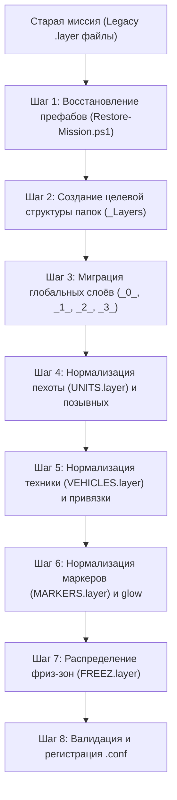

# Руководство по стандартизации и миграции TvT-миссий (Podval TvT Standard)

Данный документ содержит полное руководство, правила и технические стандарты для создания новых и адаптации устаревших (legacy DRG-era) TvT-миссий Arma Reforger к современному стандарту проекта **PodvalTvTMissions**.

Руководство предназначено как для ручной работы картоделов, так и в качестве системной инструкции (System Prompt / Workflow Specification) для автономных ИИ-агентов.

---

## 0. Фундаментальный принцип безопасности: Модель Источник-Приёмник (Source -> Destination)

> **КРИТИЧЕСКОЕ ПРАВИЛО:**  
> **Исходная директория миссий (архив `PodvalCommunityEvent`) является СТРОГО READ-ONLY (только чтение).**  
> Ни скрипт, ни ИИ-агент, ни человек **НИКОГДА** не удаляют и не изменяют файлы в исходном архиве.

### Схема изоляции:
1. **Источник (`SourceMission`)**:  
   Например: `<ПАПКА_СТАРЫХ_МИССИЙ>\Worlds\Peroi\Zarichne\Zavod_Zarichne`.  
   *Статус:* Неприкосновенный эталонный архив. Из него данные **только считываются/копируются**.
2. **Копирование в аддон (`DestDir`)**:  
   Миссия первоначально целиком копируется в репозиторий рабочего мода:  
   `<РЕПОЗИТОРИЙ>\PodvalTvTMissions\Worlds\Peroi\Zarichne\Zavod_Zarichne`.
3. **Все правки — только в копии**:  
   Все последующие шаги (ремаппинг префабов, создание папок `BLUFOR`/`OPFOR`, перенос объектов в `UNITS.layer`/`VEHICLES.layer` и последующее удаление опустевших старых файлов `rus.layer`, `us.layer`, `log.layer`) выполняются **ИСКЛЮЧИТЕЛЬНО внутри скопированной рабочей папки в репозитории `PodvalTvTMissions`**.
4. **Гарантия сохранности**:  
   Оригинальная миссия в архиве всегда остаётся нетронутой. В случае любых непредвиденных ошибок рабочую папку в репозитории можно просто удалить и скопировать заново из архива.

### Входные параметры от оператора (Operator Inputs):
Для запуска процедуры ИИ-агенту требуются два пути:
* **`SourceMission`**: Полный путь к папке исходной старой миссии.  
  *Пример:* `<ПАПКА_СТАРЫХ_МИССИЙ>\Worlds\Peroi\Zarichne\Zavod_Zarichne`
* **`DestDir`**: Полный путь к целевой папке в репозитории мода (куда миссия должна быть скопирована и развёрнута).  
  *Пример:* `<РЕПОЗИТОРИЙ>\PodvalTvTMissions\Worlds\Peroi\Zarichne`

> **Правило для ИИ-Агента:** Если оператор не предоставил один или оба пути, агент обязан запросить их перед началом любых манипуляций.

> **Важно:** конкретные пути конкретного компьютера **никогда** не записываются в репозиторий. Инструмент хранит их в локальном файле `Tools/tool.config.json`, который находится в `.gitignore`. См. раздел «Установка инструмента» в [`README.md`](README.md).

---

## 1. Стандарт именования миссии при переносе (`TvT_ИмяМиссии_Карта`)

Все переносимые миссии обязаны строго приводиться к каноническому тройному стандарту именования:

$$\mathbf{TvT\_[ИмяМиссии]\_[Карта]}$$

### Архитектура каталогов и файлов:
```text
DestDir/
└── TvT_<ИмяМиссии>_<Карта>/                  # 1. Корневая папка миссии
    ├── TvT_<ИмяМиссии>_<Карта>.ent           # 2. Файл мира (SubScene)
    ├── TvT_<ИмяМиссии>_<Карта>.ent.meta      # 3. Мета-файл мира (с ResourcePath)
    └── TvT_<ИмяМиссии>_<Карта>_Layers/       # 4. Каталог слоёв миссии
        ├── _0_DESCRIPTION.layer
        ├── _1_GAME_MODE.layer
        ...
```

### Правила нормализации имён:
1. **Обязательный префикс `TvT_`:**  
   Если старая папка в архиве называлась без префикса (например, `Zavod_Zarichne`, `Airfield_Zargabad`, `7_Day_Zargabad`), при переносе в `DestDir` обязательно добавляется префикс:  
   $\to$ `TvT_Zavod_Zarichne`, `TvT_Airfield_Zargabad`, `TvT_7_Day_Zargabad`.
2. **Обязательный суффикс карты `_<Карта>`:**  
   В конце названия всегда указывается карта с заглавной буквы: `_Zarichne`, `_Zargabad`, `_Marnivka`, `_Arland`. Если в старом имени карта отсутствовала (например, `Lewis`), суффикс добавляется: $\to$ `TvT_Lewis_Zargabad`.
3. **Правило синхронизации трёх звеньев:**  
   Имя папки, файл мира `.ent` и папка слоёв `_Layers` обязаны называться строго одинаково:
   * Папка: `TvT_<ИмяМиссии>_<Карта>/`
   * Мир: `TvT_<ИмяМиссии>_<Карта>.ent`
   * Слои: `TvT_<ИмяМиссии>_<Карта>_Layers/`
4. **Обновление `.ent.meta` и `.conf`:**  
   При нормализации имени мира `.ent`:
   * В `.ent.meta` параметр `ResourcePath` обновляется на новый путь.
   * В конфиге `Missions/<Author>/TvT_<ИмяМиссии>_<Карта>.conf` путь `World` обновляется на новый `.ent`.

---

## 2. Архитектура и файловая иерархия слоёв

В Enfusion Engine структура дерева слоёв мира определяется **исключительно файловой иерархией** внутри каталога `TvT_<ИмяМиссии>_<Карта>_Layers/`. Подпапки внутри него становятся родительскими группами слоёв (папками слоёв) в World Editor, а файлы `.layer` — отдельными слоями. Дополнительных `.meta`-файлов для слоёв не требуется.

### Стандартное дерево слоёв:

```text
TvT_<ИмяМиссии>_<Карта>_Layers/
├── _0_DESCRIPTION.layer        # Лор, правила, условности (PS_MissionDescription)
├── _0_OBJECTIVES.layer         # Триггеры условий победы/поражения (PS_Objective)
├── _1_GAME_MODE.layer          # GameMode, AIWorld, PerceptionManager, MapEntity
├── _1_GAME_LOGIC.layer         # Таймеры миссии, крит. потери, захват зон
├── _2_FLAGS.layer              # Флагштоки захвата (E_FlagPole... + SCR_FlagComponent)
├── _2_PROPS.layer              # Укрепления, мешки, статические объекты, остовы техники, турели
├── _3_ZONES.layer              # Границы карты и полизоны (PolyZone_Border)
├── BLUFOR/                     # Папка стороны BLUFOR (США / ВСУ / ТКА и т.д.)
│   ├── FREEZ.layer             # Зоны ограничения фризтайма стороны
│   ├── MARKERS.layer           # Маркеры отделений и техники стороны
│   ├── UNITS.layer             # ИСКЛЮЧИТЕЛЬНО пехотные отделения (SCR_AIGroup)
│   └── VEHICLES.layer          # ИСКЛЮЧИТЕЛЬНО техника стороны (Vehicle)
├── OPFOR/                      # Папка стороны OPFOR (ВС РФ / ЧСО / и т.д.)
│   ├── FREZZ.layer             # Зоны ограничения фризтайма стороны
│   ├── MARKERS.layer           # Маркеры отделений и техники стороны
│   ├── UNITS.layer             # ИСКЛЮЧИТЕЛЬНО пехотные отделения (SCR_AIGroup)
│   └── VEHICLES.layer          # ИСКЛЮЧИТЕЛЬНО техника стороны (Vehicle)
└── INDFOR/                     # (При наличии) Папка стороны INDFOR (Талибы / НАПА / ION)
    ├── FREEZ.layer
    ├── MARKERS.layer
    ├── UNITS.layer
    └── VEHICLES.layer
```

### Назначение цифровых префиксов `_0_`, `_1_`, `_2_`
В Enfusion World Editor слои мира по умолчанию сортируются в алфавитном порядке. Использование цифровых префиксов гарантирует, что системные и общеигровые слои всегда располагаются в самом верху дерева слоёв над папками фракций (`BLUFOR`, `INDFOR`, `OPFOR`).

---

## 3. Спецификация системных слоёв

### 2.1. `_0_DESCRIPTION.layer`
Содержит описание брифинга миссии.
* **Базовый класс:** `$grp PS_MissionDescription : "{3136BE42592F3B1B}PrefabsEditable/MissionDescription/EditableMissionDescription.et"`
* **Обязательные сущности и именование:**
  * `_0_ABOUT` — вводная информация, описание операции, лор.
  * `_1_RULES` — задачи сторон, условности, технические правила (например, запрет камикадзе на вертолётах).
* **Обязательные параметры:**
  * `m_sDescriptionLayout "{B6DE04F7CF7A95DA}UI/MissionDescription/DescriptionEditableScrollable.layout"` — стиль с возможностью скролла для больших текстов.
  * `m_iOrder` — порядковый номер вкладки (начиная с 0).
  * `m_bEmptyFactionVisibility 1`, `m_bShowForAnyFaction 1` — видимость для зрителей и всех фракций.

### 2.2. `_0_OBJECTIVES.layer`
Содержит сущности целей миссии для лобби.
* **Базовый класс:** `$grp PS_Objective : "{A4F0B4846EF850C4}Prefabs/Objective/Objective.et"`
* **Именование:** Осмысленные идентификаторы (например, `OBJ_USAF_WIN`, `OBJ_AFRF_HOLD`, `KILL_VIP`).
* **Параметры:**
  * `m_sTitle` — человекочитаемый текст задачи.
  * `m_sFactionKey` — ключ целевой фракции (`RHS_USAF`, `RHS_AFRF` и т.д.).
  * `m_iScore` — очки за выполнение (обычно 50 или 100).

### 2.3. `_1_GAME_MODE.layer`
Мультиплеерный костяк мира.
* `SCR_AIWorld : "{E0A05C76552E7F58}Prefabs/AI/SCR_AIWorld.et"` (или `{672531FAC0834C06}`).
* `PerceptionManager PerceptionManager1 : "{028DAEAD63E056BE}Prefabs/World/Game/PerceptionManager.et"`.
* `PS_GameModeCoop PS_GameMode_Lobby1 : "{9C2001FE7A2F2281}Prefabs/MP/Modes/PS_GameMode_Lobby.et"`:
  * Вложенный компонент: `SCR_TimeAndWeatherHandlerComponent` (`m_iStartingHours`, `m_iStartingMinutes`).
  * Параметр: `m_iFreezeTime 300000` (5 минут фризтайма = 300 000 мс).
* `SCR_MapEntity` — добавляется только если террейн требует переопределения топологии/спутниковой карты (например, Марнивка). Для базовых карт (Заргабад, Эверон) берётся из родительского `.ent`.

### 2.4. `_1_GAME_LOGIC.layer`
Логические триггеры завершения и контроля игры.
* `GenericEntity : "{E6FC6DD69FA3479F}Prefabs/System/DRG_MissionEndTimerPrefab.et"`:
  * Компонент: `DRG_MissionEndTimerComponent` (`m_iMissionTime` в секундах, например `2400` = 40 мин; `m_aTimeLeftWarningTimers { 300 }` = оповещение за 5 мин).
* `GenericEntity : "{6A3CDCFB475BF1B2}Prefabs/System/DRG_CriticalLossPrefab.et"` — триггер критических потерь (опционально).
* `GenericEntity : "{592E8C59C778A189}Prefabs/System/GUB_ZoneControlBetweenFactionsPrefab.et"` — триггер перетягивания зон (опционально).

### 2.5. `_2_FLAGS.layer`
Флагштоки для захвата ключевых точек.
* `GenericEntity : "{F5EF4223ACA6169C}PrefabsEditable/Auto/Structures/Military/Flags/E_FlagPole_02_V1_AFRF.et"`
* Содержит компонент: `SCR_FlagComponent` с массивом `m_aFlagData` (`PS_FlagData` с указанием `m_sFactionKey` и `m_iCaptureCounter 1`).

### 2.6. `_2_PROPS.layer`
Статическое окружение, возведённые укрепления, мешки с песком, вышки, остовы подбитой техники, деревья/кусты.
* **Стационарные турели:** Если на позициях предусмотрены станковые пулемёты (НСВ, Корд, Браунинг), АГС или ПТРК (Корнет, TOW), они размещаются в этом слое (либо в подпапке фракции `DEPLOYABLE.layer`), но **ни в коем случае не в слое пехоты** `UNITS.layer`.

### 2.7. `_3_ZONES.layer`
Игровые границы и зоны запрета выхода.
* `PolylineShapeEntity : "{7019844BAD5C4DD8}Prefabs/PolyZone/PolyZone_Border.et"`
* Компоненты: `PS_PolyZone` (цвета, ширина границы, список разрешённых фракций `m_aVisibleForFactions`) и точки `Points { ShapePoint ... }`.
* Дочерний триггер: `PS_PolyZoneTrigger` с параметром `m_sGroupKey` (привязка к группе или стороне).

---

## 4. Спецификация слоёв фракций (`BLUFOR/`, `OPFOR/`, `INDFOR/`)

Каждая сторона изолирована в собственной подпапке и содержит строго 4 файла:

### 3.1. `FREEZ.layer`
Зоны фризтайма, запрещающие игрокам покидать спавн до старта раунда.
* **Класс:** `SCR_EditorRestrictionZoneEntity` (Medium `{6144B0BE2EAC6897}`, Small `{EF72FA7CD87618D5}`, Large `{B2A519402E9AC209}`).
* Должны размещаться строго над координатами спавна отделений и техники данной стороны. Запрещено смешивать зоны разных сторон в один файл.

### 3.2. `UNITS.layer` (Именование отделений и позывные)
Содержит **исключительно** пехотные группы `SCR_AIGroup`. Наличие техники или турелей здесь строго запрещено!

#### Формула именования группы: `<SimpleFactionKey>_<Callsign>`
Пример: `CDF_201`, `USAF_010`, `RU_000`.

##### А. Правило формирования 3-значного позывного (`Callsign`):
Позывной формируется из трёх целочисленных параметров компонента **`PS_GroupCallsignAssigner`**:
1. `m_iCompanyCallsign` — рота (1-я цифра / сотни). Если не указано = `0`.
2. `m_iPlatoonCallsign` — взвод (2-я цифра / десятки). Если не указано = `0`.
3. `m_iSquadCallsign` — отделение (3-я цифра / единицы). Если не указано = `0`.

$$\text{Callsign} = (C \times 100) + (P \times 10) + S$$

* Пример со скриншота: $C = 2$, $P = 0$, $S = 1 \implies \mathbf{201} \implies \mathbf{CDF\_201}$.
* Штаб стороны: $C = 0$, $P = 0$, $S = 0 \implies \mathbf{000} \implies \mathbf{USAF\_000}$.
* 1-й взвод, 1-е отд.: $C = 0$, $P = 1$, $S = 0 \implies \mathbf{010} \implies \mathbf{RU\_010}$.
* 1-й взвод, 2-е отд.: $C = 0$, $P = 1$, $S = 1 \implies \mathbf{011} \implies \mathbf{RU\_011}$.
* 2-я рота (мех. взвод): $C = 1$, $P = 1$, $S = 0 \implies \mathbf{110} \implies \mathbf{USAF\_110}$.

##### Б. Таблица сокращений `SimpleFactionKey`:
| Полный ключ фракции | `SimpleFactionKey` | Папка стороны |
| :--- | :--- | :--- |
| `RHS_USAF` | **`USAF`** (или `US`) | `BLUFOR/` |
| `RHS_AFRF` | **`RU`** (или `AFRF`) | `OPFOR/` |
| `Ses_CDF` | **`CDF`** | `BLUFOR/` |
| `Ses_ChDKZ` | **`ChDKZ`** | `OPFOR/` |
| `Ses_TKR` | **`TKR`** | `INDFOR/` или `OPFOR/` |
| `Ses_TKA` | **`TKA`** | `OPFOR/` |
| `Ses_NAPA` | **`NAPA`** | `INDFOR/` |
| `RHS_ION` | **`ION`** | `INDFOR/` |
| `US` | **`US`** | `BLUFOR/` |
| `USSR` | **`USSR`** | `OPFOR/` |
| `FIA` | **`FIA`** | `INDFOR/` |

### 3.3. `VEHICLES.layer` (Привязка техники к группам)
Содержит **исключительно** технику стороны `Vehicle`.
* **Именование техники:** Имя машины строится от имени своей группы:  
  `<GroupName>_V` (например, `USAF_010_V`, `CDF_201_V`) или `_V2`, `_V3` при наличии нескольких машин.
* **Привязка к группе (`m_sAttachmentGroupName`):**  
  Параметр **обязан в точности совпадать** с именем группы из `UNITS.layer`:
  ```c
  Vehicle LAV25_RHS1 : "{3312ADBF53A16DD9}Prefabs/Vehicles/Wheeled/LAV25/LAV25_RHS.et" {
   coords 2871.874 67.014 3043.868
   m_sAttachmentGroupName "USAF_110"
  }
  ```
  *Критично:* благодаря этому параметру в лобби игры экипаж видит закреплённую технику под слотом своего отделения.

### 3.4. `MARKERS.layer` (Маркеры на карте)
Содержит маркеры отделений и техники (`PS_ManualMarker`).

#### А. Маркеры отделений:
* **Именование сущности:** `<FullFactionKey>_G_<Callsign>_M`  
  (например: `RHS_USAF_G_010_M`, `Ses_CDF_G_201_M`, `RHS_AFRF_G_000_M`).
* **Imageset флага и контура (Glow):**
  * **BLUFOR:**
    * `m_sImageSet "{1228936E5DB30403}UI/Textures/GroupManagement/FlagIcons/GroupFlagsBlufor.imageset"`
    * `m_sImageSetGlow "{D1BFDF90DD7A4E01}UI/Textures/GroupManagement/FlagIcons/GroupFlagsBlufor-outline.imageset"`
  * **OPFOR:**
    * `m_sImageSet "{7CD99D22C7AE8195}UI/Textures/GroupManagement/FlagIcons/GroupFlagsOpfor.imageset"`
    * `m_sImageSetGlow "{B9356E7B2E974DCD}UI/Textures/GroupManagement/FlagIcons/GroupFlagsOpfor-outline.imageset"`
  * **INDFOR:**
    * `m_sImageSet "{301FC1A2A46D3E0D}UI/Textures/GroupManagement/FlagIcons/GroupFlagsIndfor.imageset"`
    * `m_sImageSetGlow "{C07D82625600BA21}UI/Textures/GroupManagement/FlagIcons/GroupFlagsIndfor-outline.imageset"`
* **Иконка (`m_sQuadName`):**  
  **Запрещено оставлять значение `"undefined"`!**  
  Использовать осмысленные квады:
  * `"commander"` — штаб / командир роты / взвода.
  * `"infantry"` — стрелковые отделения.
  * `"recon"` — разведка / спецназ / снайперы.
  * `"motorized"` / `"armor"` — бронетехника / экипажи.
  * `"medical"` — медики.
* **Локализация позывного в `m_sDescription`:**  
  Использовать актуальные строковые теги мода `#PDVL_Squad_...` (старые теги `#DRG-Sq-...` признаны устаревшими):
  * `(#PDVL_Squad_PLHQ)` — штаб взвода / роты (`Aktiv 1-1`, `Atlas 1-1`).
  * `(#PDVL_Squad_Rifle)` — стрелковое отделение.
  * `(#PDVL_Squad_Recon)` — разведка.
  * `(#PDVL_Squad_Sniper)` — снайперская пара.
  * `(#PDVL_Squad_Crew)` — экипаж техники.
  * `(#PDVL_Squad_Pilot)` — пилоты.
  * `(#PDVL_Squad_Medic)` — санитарное отделение.
  * `(#PDVL_Squad_Sapper)` — сапёры / инженеры.
  * `(#PDVL_Squad_BigMG)` / `(#PDVL_Squad_NSV)` — пулемётное отделение.
  * `(#PDVL_Squad_PTRK)` — противотанковый расчёт.
* **Видимость и Z-порядок:**
  * `m_aVisibleForFactions` — перечислить все участвующие стороны (чтобы на брифинге маркеры видели все).
  * `m_bVisibleForEmptyFaction 1` — чтобы маркеры видели зрители/администраторы в слоте Empty.
  * `m_iZOrder 10`.

#### Б. Маркеры техники:
* `m_sImageSet "{F3A9B47F55BE8D2B}UI/Textures/Icons/PS_Atlas_x64.imageset"`
* `m_sQuadName` — `"APC"`, `"Car"`, `"Helicopter"`, `"Tank"`, `"Truck"` и т.д.
* `m_sDescription` — локализованное имя техники (например, `"#AR-Vehicle_BTR70_Name"`).
* `m_bUseWorldScale 1`
* `m_aHideOnGameModeStates { 1 }` — **обязательно!** Скрывает маркер техники на карте после завершения брифинга и старта игры.
* `m_iZOrder 0`.

---

## 5. Матрица типичных дефектов устаревших миссий

| Компонент | Как сделано в старых миссиях (DRG-era) | Как должно быть по новому стандарту |
| :--- | :--- | :--- |
| **Расположение файлов** | Все `.layer` сгружены в корень без разделения по фракциям | Изолированные подпапки `BLUFOR/`, `OPFOR/`, `INDFOR/` |
| **Имена отделений** | Случайные (`bb`, `bb1`, `gg`, `lav`) или анонимные `{}` | Строгий формат `<SimpleFactionKey>_<Callsign>` (`CDF_201`) |
| **Разделение пехота/техника** | Пехота, БТР и пулемёты свалены в одном файле `rus.layer` | Пехота строго в `UNITS.layer`, техника в `VEHICLES.layer` |
| **Привязка техники** | `m_sAttachmentGroupName "bb"` или пусто | `m_sAttachmentGroupName "RU_010"` |
| **Иконка маркера** | `m_sQuadName "undefined"` | `"commander"`, `"infantry"`, `"recon"`, etc. |
| **Обводка маркера** | `m_sImageSetGlow ""` | Задан соответствующий imageset с суффиксом `-outline` |
| **Теги позывных** | `#DRG-Sq-PlatoonHQ`, `#DRG-Sq-RifleSquad` | `#PDVL_Squad_PLHQ`, `#PDVL_Squad_Rifle` |
| **Фриз-зоны** | Все зоны обеих сторон сгружены в общий `friz.layer` | Разнесены по спавнам в `<Faction>/FREEZ.layer` |
| **Свалка логики** | Таймер, задачи и флагштоки сгружены в `log.layer` | Разнесены: `_1_GAME_LOGIC`, `_0_OBJECTIVES`, `_2_FLAGS` |
| **Декорации** | Нестандартный слой `domiki.layer` | Стандартизированный слой `_2_PROPS.layer` |

---

## 6. Пошаговый алгоритм миграции (Workflow)



### Шаг 1: Безопасное копирование и восстановление префабов
> **Напоминание:** Исходная папка `-SourceMission` остаётся нетронутой. Скрипт копирует её в `-DestDir` (внутри репозитория `PodvalTvTMissions`) и правит ссылки уже в рабочей копии.

Запустить скрипт `Tools/Restore-Mission.ps1`:
```powershell
.\Restore-Mission.ps1 `
    -SourceMission "<ПАПКА_СТАРЫХ_МИССИЙ>\Worlds\Peroi\Zarichne\Zavod_Zarichne" `
    -DestDir "<РЕПОЗИТОРИЙ>\PodvalTvTMissions\Worlds\Peroi\Zarichne" `
    -Force
```
> Пути `AddonRoot` и `PrefabsModRoot` скрипт берёт из локального файла настроек (см. [`README.md`](README.md)). Параметры командной строки имеют приоритет над настройками.
1. Скрипт физически копирует миссию из архива в каталог аддона.
2. Автоматически выполняет ремаппинг устаревших префабов старого DRG-мода по таблице `Tools/remap_table.json` **внутри рабочей копии**.
3. Обновляет внутренний путь ресурса в `.ent.meta`.

> Если ссылка битая и её нет в таблице, скрипт её не починит — он только сообщит о ней. Чтобы увидеть заранее, какие префабы вообще требуют назначения, запустите скан старых миссий: `Tools/Scan-Legacy.ps1` (сухой прогон) или кнопка **«⌕ Просканировать старые миссии»** в редакторе базы замен. Скан объявляет все найденные битые ссылки заглушками в `remap_table.json`; уже назначенные замены он не трогает, поэтому запускать его можно многократно. Отчёт о том, сколько раз и в каких миссиях встречается каждый префаб, показывает вкладка **«Использование»**.

### Шаг 2: Создание структуры папок
В каталоге `<MissionName>_Layers/` создать папки участвующих сторон (`BLUFOR/`, `OPFOR/`, при наличии — `INDFOR/`).

### Шаг 3: Распределение системных слоёв
1. Из старого `desc.layer` перенести `PS_MissionDescription` в `_0_DESCRIPTION.layer`. Назначить имена `_0_ABOUT`, `_1_RULES`, добавить скролл-лейаут и `m_iOrder`.
2. Из старого `log.layer` перенести:
   * Все `PS_Objective` $\to$ `_0_OBJECTIVES.layer`.
   * Таймер `DRG_MissionEndTimerPrefab` $\to$ `_1_GAME_LOGIC.layer`.
   * Флагштоки `E_FlagPole...` $\to$ `_2_FLAGS.layer`.
3. Из старого `default.layer` перенести `PS_GameModeCoop`, `SCR_AIWorld`, `PerceptionManager` $\to$ `_1_GAME_MODE.layer`. Проверить `m_iFreezeTime 300000`.
4. Из старого `domiki.layer` перенести все пропсы, мешки, статические остовы техники $\to$ `_2_PROPS.layer`. Перенести сюда же стационарные пулемёты/АГС/ПТРК, если они лежали в слое пехоты.
5. Из старого `zone.layer` перенести полизоны $\to$ `_3_ZONES.layer`.

### Шаг 4: Нормализация пехоты (`UNITS.layer`)
1. Перенести все `SCR_AIGroup` в `<Faction>/UNITS.layer`.
2. Прочитать из каждого `PS_GroupCallsignAssigner` значения `m_iCompanyCallsign`, `m_iPlatoonCallsign`, `m_iSquadCallsign` (если поле опущено — считать `0`).
3. Сформировать позывной `"{0}{1}{2}" -f $C, $P, $S` и имя группы: `<SimpleFactionKey>_<Callsign>` (например, `CDF_201`).
4. Зафиксировать таблицу переименования: `СтароеИмя -> НовоеИмя` (например, `bb -> RU_010`).

### Шаг 5: Нормализация техники (`VEHICLES.layer`)
1. Перенести всю технику `Vehicle` соответствующей стороны в `<Faction>/VEHICLES.layer`.
2. Найти, к какой старой группе относилась машина (по старому `m_sAttachmentGroupName` или по близости к спавну пехоты).
3. Присвоить машине имя `<NewGroupName>_V` (например, `RU_010_V`).
4. Обновить `m_sAttachmentGroupName` на `<NewGroupName>`.

### Шаг 6: Нормализация маркеров (`MARKERS.layer`)
1. Перенести маркеры отделений и техники в `<Faction>/MARKERS.layer`.
2. Для маркеров отделений:
   * Переименовать маркер в `<FullFactionKey>_G_<Callsign>_M`.
   * Добавить соответствующий `m_sImageSetGlow` (контур флага).
   * Заменить `m_sQuadName "undefined"` на `"commander"` или `"infantry"`.
   * Заменить устаревшие теги `#DRG-Sq-...` на актуальные `#PDVL_Squad_...`.
3. Для маркеров техники:
   * Проверить `m_sImageSet "{F3A9B47F55BE8D2B}UI/Textures/Icons/PS_Atlas_x64.imageset"`.
   * Убедиться в наличии `m_aHideOnGameModeStates { 1 }`.

### Шаг 7: Распределение фриз-зон (`FREEZ.layer`)
1. Взять все `SCR_EditorRestrictionZoneEntity` из старого `friz.layer`.
2. Для каждой зоны рассчитать расстояние до центроида спавнов отделений каждой стороны:
   $$D = \sqrt{(X_{zone} - X_{spawn})^2 + (Z_{zone} - Z_{spawn})^2}$$
3. Поместить зону в `FREEZ.layer` той стороны, к которой она расположена ближе всего.
4. Удалить старый файл `friz.layer`.

### Шаг 8: Валидация и конфиг миссии
1. Убедиться, что старые разрозненные файлы (`rus.layer`, `us.layer`, `log.layer`, `desc.layer`, `domiki.layer`, `default.layer`) удалены, а всё их содержимое перемещено в новые слои.
2. Проверить файл `Missions/<Author>/<MissionName>.conf`:
   * Ссылка на мир: `World "{GUID}Worlds/<Author>/<MissionName>/<MissionName>.ent"`.
   * Название миссии: `m_sName "..."`.
   * Настройки погоды и времени: `m_bOverrideScenarioTimeAndWeather 1`, `m_iStartingHours ...`.
